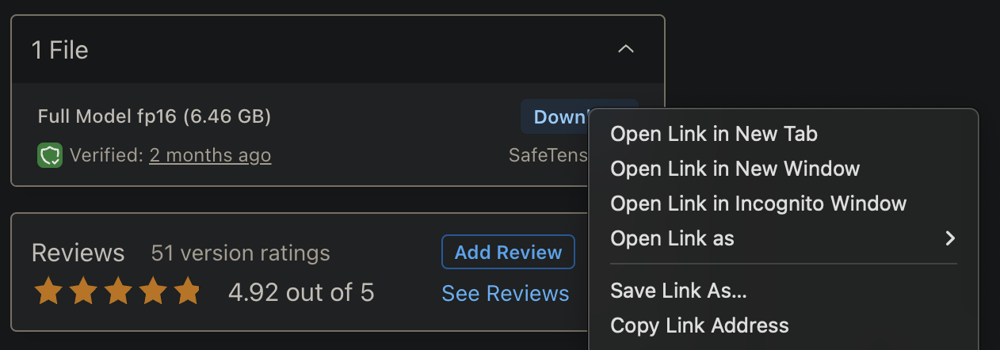

# Civitai SDXL Safetensor Cog template

This is a template to push a Civitai SDXL model as a Cog model. [Cog packages machine learning models as standard containers.](https://github.com/replicate/cog)

First, get a Civitai SDXL Model URL and download the safetensors file:

    wget -O model.safetensors https://civitai.com/api/download/models/154625?type=Model&format=SafeTensor&size=full&fp=fp16

To get the URL, find the safetensors file and select "Copy Link Address"

Then run the script convert to Diffusers, and download weights needed for SDXL (VAE, safety checker):

    cog run script/download-weights

Then, you can run predictions:

    cog predict -i prompt="An astronaut riding a rainbow unicorn"

And finally push to Replicate:

    cog login
    cog push r8.im/<Replicate_Username>/<Replicate_Model_name>

Example:

## License

The code in this repository is licensed under the [Apache License 2.0](LICENSE).

The model weights are not covered by this license. This template loads a Civitai SDXL checkpoint of your choice, so the weights follow that checkpoint's own Civitai license, and SDXL itself is under the [CreativeML Open RAIL++-M](https://huggingface.co/stabilityai/stable-diffusion-xl-base-1.0/blob/main/LICENSE.md) license. Check both before use.
